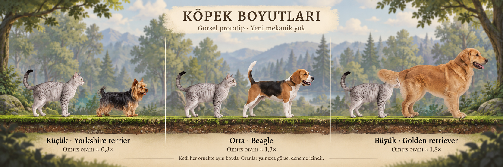

# Köpek türü ve boyut çeşitliliği — görsel prototip kararı

2026-10-20 kullanıcı kararı: **Önce yalnız görsel boyut/tür prototipi hazırla.**
Bu karar rampa, yeni geçiş mekaniği, zorluk veya canlı oyunda boyut değişikliği
onayı değildir. Mevcut oyunun köpekleri ve collider'ları bu çalışma kapsamında
değiştirilmedi.

## Mevcut uygulama

LevelCourseBuilder.CreateDog normal köpek için 2,75 dünya birimi hedef görsel
genişlik, 1,98×1,05 trigger ve ayak konumlandırması kullanır. Robotta ayrı değerler
vardır (1,95 görsel genişlik; 1,30×0,82 trigger). Bunlar gerçek metre ölçeği değildir.
Zorluk esas olarak hız/adet/yerleşimden gelir; normal köpekler için farklı ırk ve
beden sınıfları tanımlı değildir. Mevcut gerçekçi köpek görseli golden retriever
benzeri tek bir varlıktır; yüksekliği kaynak resmin en-boy oranıyla belirlenir.

Kedi hedef sprite yüksekliği 2,0×1,25×CatScale×kedi çarpanıdır; CatScale normalde
1, büyük görünümde 1,2. Sprite'ın şeffaf payı, poz ve ırk silueti gerçek görünen
beden yüksekliğini etkiler. Bu nedenle köpek ile kedinin aynı boyda algılanması
yalnız collider boyutundan açıklanamaz.

## İlk görsel karşılaştırma

| Seçenek | Görsel tür önerisi | Kedi omuz yüksekliğine göre taslak hedef |
| --- | --- | --- |
| Küçük | Yorkshire terrier | yaklaşık 0,8× |
| Orta | Beagle | yaklaşık 1,3× |
| Büyük | Golden retriever | yaklaşık 1,8× |

Her panelde aynı ölçekte gri tekir kedi referansı, ortak yer çizgisi ve aynı bakış
yönü kullanıldı. Bu AI konsept görselindeki oranlar yön belirtir; piksel ölçümüyle
kalibre edilmiş animasyon atlasları değildir. Yaklaşık oranlar gerçek hayattaki
ırkların kesin boy ölçüsü iddiası da değildir. Üretim varlığı yapılmadan önce
seçilen türün ayak tabanı, omuz çizgisi ve bütün animasyon kareleri sabit bir ölçüye
kaydedilmelidir.

Görsel `imagegen` becerisinin yerleşik image_gen aracıyla üretildi. Tam istem,
referansların rolleri ve çıktı bilgisi [istem kaydında](prototypes/dog-sizes-v1-prompt.md).
Kaynak köpek mevcut dog_idle.png; stil/kedi referansı güncel orman kamera çıktısıdır.
Prototip Assets dışında tutulur ve oyuna ithal edilmez.

## Sonraki ürün kararı ve teknik sınırlar

İlk değerlendirme yalnız hangi siluet/boyut ayrımının okunaklı olduğudur. Büyük
köpeğe rampa zorunluluğu seçilmedi. Seçilen görsel onaylanırsa üretim öncesinde
üç seçenek karşılaştırılmalıdır: yalnız dekoratif görsel değişimi, mevcut zıplama
kurallarına uyan beden/collider değişimi veya ayrı büyük-köpek mekaniği. Görseli
büyütüp eski küçük collider'ı sessizce korumak yanıltıcı olur.

Yeni türün oyuna girmesi için kendi bekleme/koşma/yön değiştirme kareleri, ortak
ayak tabanı, animasyon ölçeği, collider ile görünen beden uyumu ve gerektiğinde
ezilme efekti gerekir. Yeni hareket/engel mekaniği seçilirse iki mod, çift zıplama,
köpeğin üstüne iniş, ağaç güvenliği, çukur yaklaşımı ve mevcut bölüm bütçesiyle
tamamlanabilirlik ayrıca doğrulanmalıdır. Çizim bütçesi bu prototip için artırılmadı.

Yol bütçesi ayrı doğrulamada tasarım gereği olarak belgelendi:
[DRAWING_BUDGET_RULES_QA.md](DRAWING_BUDGET_RULES_QA.md). Kamera görünümü geçişi
yeni bütçe değildir; numaralı bölüm ve yeniden deneme tam bütçe atar.
